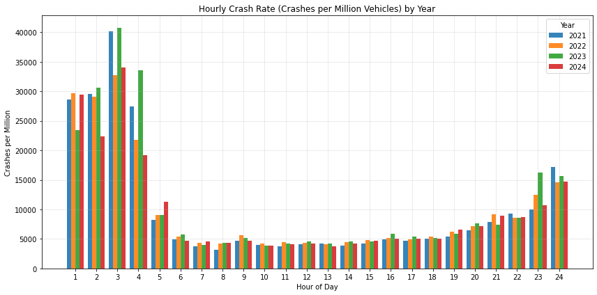
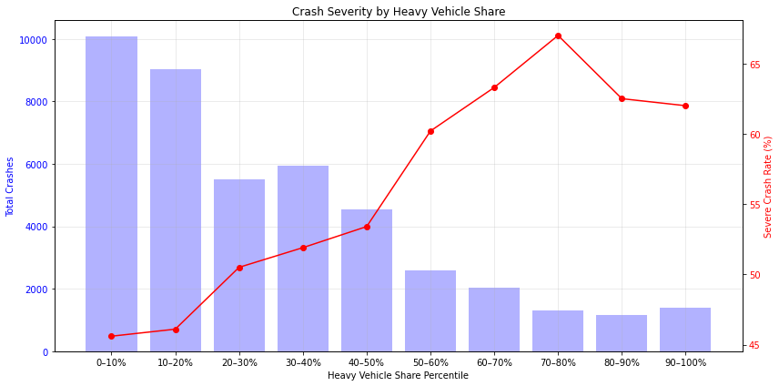
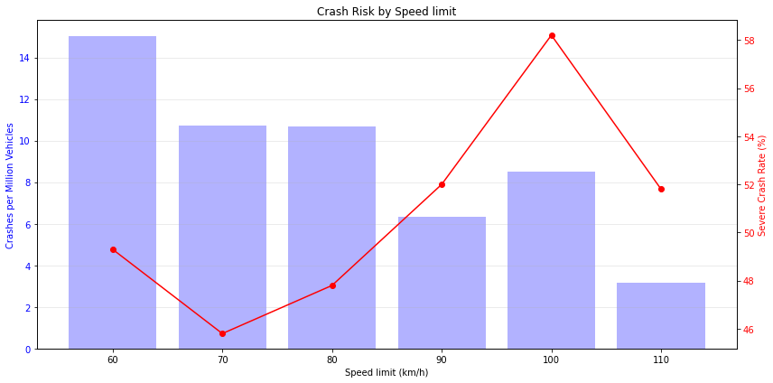
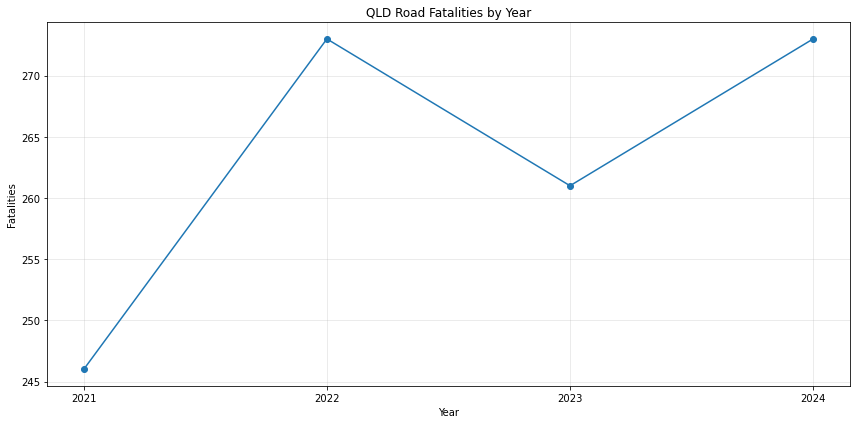
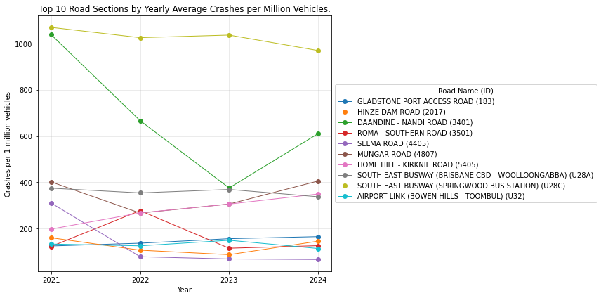
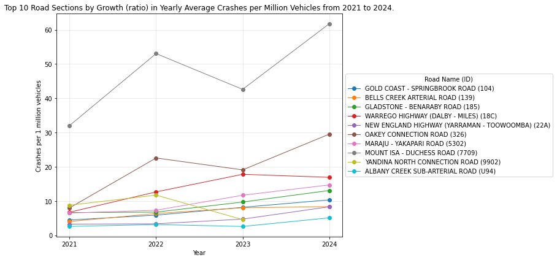
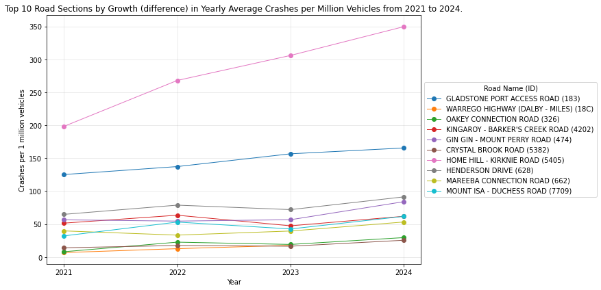
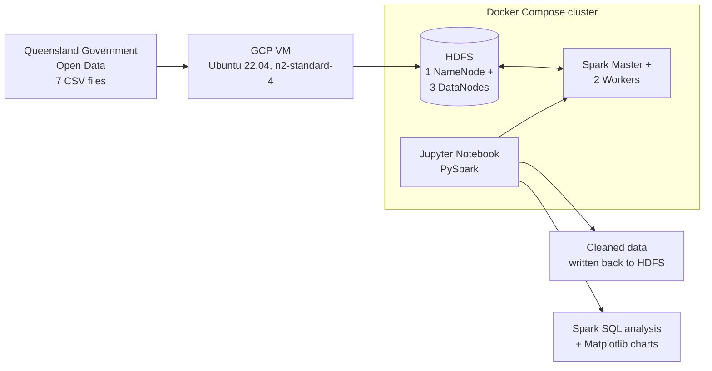

# Queensland Road Crash Risk Analysis (2021–2024)

**Distributed big data analysis of ~4.4 million records of Queensland road, traffic and crash data, using Apache Spark and Hadoop (HDFS) running in Docker on Google Cloud.**

The goal was to move beyond raw crash counts and ask *where and when driving is actually riskiest per vehicle on the road*, by joining crash records to traffic volumes for each road section.


---

## Key findings

| # | Finding                                                                                                                                                                                                                              |
| - | ------------------------------------------------------------------------------------------------------------------------------------------------------------------------------------------------------------------------------------ |
| 1 | **Night driving is far riskier per vehicle.** Between midnight and 4am, the crash rate per vehicle is typically **5–10× the daytime rate**, peaking between 2am and 3am. The pattern holds in all four years.          |
| 2 | **Heavy vehicles make crashes more serious.** On road sections with the most heavy-vehicle traffic, **~62–67%** of crashes result in hospitalisation or death, compared with **~46%** on sections with the least. |
| 3 | **Low speed limits mean more crashes; high limits mean worse ones.** 60 km/h roads have the highest crash rate per vehicle (15.0 per million), while 100 km/h roads have the highest share of severe crashes (58%).            |
| 4 | **Fatal crashes have not fallen.** Fatal crashes on Queensland roads rose from 246 in 2021 to 273 in 2024.                                                                                                                     |
| 5 | **A small number of road sections are getting markedly more dangerous**, with crash rates per vehicle growing sharply between 2021 and 2024. These are the natural candidates for safety review.                               |

### Night-time crash risk



### Heavy vehicle share vs crash severity



### Speed limit vs crash rate and severity



<details>
<summary><b>More charts</b></summary>

**Fatal crashes by year**


**Road sections with the highest average crash rate**


**Fastest-growing crash rates, 2021 → 2024 (ratio)**


**Fastest-growing crash rates, 2021 → 2024 (absolute difference)**


</details>

---

## Architecture



The whole cluster (Hadoop NameNode, 3 DataNodes, YARN ResourceManager, NodeManager and History Server, a Spark master with 2 workers, and Jupyter) is defined in a single [`docker-compose.yml`](docker-compose.yml) and runs on one Google Cloud VM.

---

## How it works

**1. Ingest.** Seven public CSV datasets are loaded into HDFS and read with PySpark: crash records, road section locations with traffic volumes, the annual traffic census, and four years of hourly traffic counts.

**2. Clean.** ~4.4 million raw records were reduced to ~4.0 million clean records. This involved removing null and out-of-scope rows, casting inconsistently typed columns, filtering coordinates to Queensland's bounding box, standardising column names, and normalising hour formats across datasets.

**3. Spatial join.** The crash data and the traffic data don't share a road identifier, so each crash was matched to its nearest road section:

- calculated the centre point of every road section,
- used a broadcast join to find candidate sections within a 0.25° box around each crash,
- computed true distances with the **haversine formula** written in native Spark functions (so it runs distributed),
- kept the closest section using a **window function** (`ROW_NUMBER` partitioned by crash).

**4. Analyse.** Spark SQL views calculate crash rates normalised by traffic volume (crashes per million vehicles), using window functions, `NTILE` banding and multi-table joins. Results are converted to pandas for plotting.

---

## Data sources

All data is public, from the [Queensland Government Open Data Portal](https://www.data.qld.gov.au/).

| Dataset                                                                                                                                                                                       | File name used                                                                             |
| --------------------------------------------------------------------------------------------------------------------------------------------------------------------------------------------- | ------------------------------------------------------------------------------------------ |
| [Crash data from Queensland roads](https://www.data.qld.gov.au/dataset/crash-data-from-queensland-roads/resource/e88943c0-5968-4972-a15f-38e120d72ec0)                                         | `1_crash_locations.csv`                                                                  |
| [Road location and traffic data](https://www.data.qld.gov.au/dataset/road-location-and-traffic-data/resource/daab3617-077f-450a-a1c0-57c26d8ba47c)                                             | `road-location-and-traffic-data_20250629.csv`                                            |
| [Traffic census, state-declared road network](https://www.data.qld.gov.au/dataset/traffic-census-for-the-queensland-state-declared-road-network/resource/b856deab-ab20-48f1-85c6-2715e3a1d42c) | `aadt_2014_2024.csv`                                                                     |
| [Traffic averaged by hour and day — 2021](https://www.data.qld.gov.au/dataset/queensland-traffic-data-averaged-by-hour-of-day-and-day-of-week/resource/44fe23b4-8519-4b3f-a24c-6a76b0076c81)  | `qld-traffic-data-average-by-hour-by-day-2021_updated.csv`                               |
| [Traffic averaged by hour and day — 2022](https://www.data.qld.gov.au/dataset/queensland-traffic-data-averaged-by-hour-of-day-and-day-of-week/resource/4d70bf41-d61e-40c6-86ce-9e61565483a4)  | `qld-traffic-data-average-by-hour-by-day-2022.csv`                                       |
| [Traffic averaged by hour and day — 2023](https://www.data.qld.gov.au/dataset/queensland-traffic-data-averaged-by-hour-of-day-and-day-of-week/resource/d2428b1b-8e3c-4850-828a-f356c5387a0b)  | `qld-traffic-data-average-by-hour-by-day-2023.csv`                                       |
| [Traffic averaged by hour and day — 2024](https://www.data.qld.gov.au/dataset/queensland-traffic-data-averaged-by-hour-of-day-and-day-of-week/resource/ef3b4602-696a-4a8b-9934-c1f76e147834)  | `qld-traffic-data-average-by-hour-by-day-2024.csv` (download as XLSX and convert to CSV) |

The CSVs are not committed to this repo because of their size.

---

## Running it yourself

**Requirements:** a Linux machine or cloud VM with Docker and Docker Compose. I used a GCP `n2-standard-4` VM (Ubuntu 22.04, 75 GiB disk).

```bash
# 1. Clone the repo
git clone https://github.com/charlieeslack/qld-road-safety-analysis.git
cd qld-road-crash-analysis

# 2. Download the CSVs listed above and move them into nbs/
mv ~/*.csv nbs/

# 3. Start the cluster (HDFS, YARN, Spark, Jupyter)
docker compose up -d

# 4. Copy the data into HDFS
docker exec -it namenode bash
hdfs dfs -mkdir -p /nbs/
hdfs dfs -put /home/nbs/*.csv /nbs/
exit
```

Then open Jupyter at `http://<vm-ip>:8888` and run the notebook in `nbs/` top to bottom.

| Service              | Port |
| -------------------- | ---- |
| Jupyter Notebook     | 8888 |
| Spark Master UI      | 8080 |
| HDFS NameNode UI     | 80   |
| YARN ResourceManager | 8089 |

---

## Limitations and next steps

Being upfront about what the analysis can and can't show:

- **Nearest-section matching is approximate.** Some crashes are matched to a road section centre several kilometres away. Matching against the road geometry itself, rather than centre points, would be more accurate.
- **Rates on very low-traffic sections are unstable.** For example, a section of the South East Busway tops the crash-rate table largely because its recorded traffic volume is very low. I filtered to sections averaging at least 10 crashes a year to reduce this effect.
- **The hourly crash rate is a relative measure.** It is based on traffic counting sites rather than total vehicles on the road, so it's best read as "how much riskier is 3am than 3pm", not as an absolute rate.
- **These are correlations, not causes.** For example, heavy-vehicle routes also tend to be faster, rural roads.
- **The year-by-year chart counts fatal crashes,** not the number of people killed.

Possible extensions: an interactive map of high-risk road sections, statistical significance testing on the trends, and an automated pipeline that refreshes as new data is published.

---

## Acknowledgements

Built as an individual project for INFS3208 (Cloud Computing) at the University of Queensland, 2025. The haversine implementation was adapted from [GeeksforGeeks](https://www.geeksforgeeks.org/dsa/haversine-formula-to-find-distance-between-two-points-on-a-sphere/), and AI assistance was used to convert it to PySpark functions and with parts of the plotting code, as noted in the notebook.

**Charlie Slack** · [LinkedIn](https://www.linkedin.com/in/charles-slack-b59936280/) · charlieslack22@gmail.com
